# Next-Sukoshi

**双端分数均高于95+，给你最佳的浏览体验**

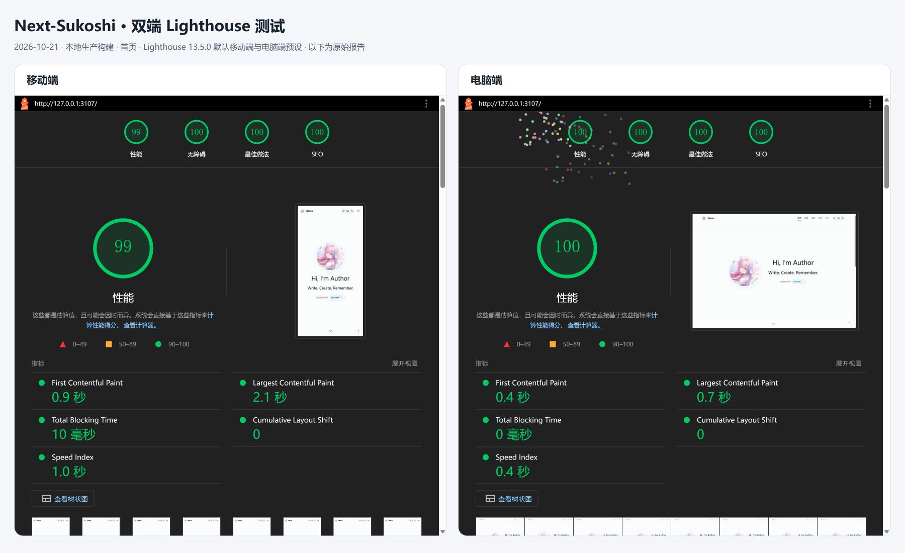

本地生产构建首页测试：移动端 **99** 分，电脑端 **100** 分，可访问性、最佳实践和搜索引擎优化均为 **100** 分。测试日期：2026-10-21，详细环境与原始报告见[性能测试](docs/performance.md)。

源自 [Soki Sugar Life](https://www.soki.moe) 的二次元风格个人博客模板，基于 **Next.js、React 和 TypeScript** 构建。用文字记录日常，用封面收藏片刻，也为书籍、漫画、动画和游戏留一处自己的空间。

首页保留个人介绍与文章卡片，内页采用简洁的双栏和卡片布局。支持日夜主题、中文思源黑体、文章归档、品鉴收藏与友链交换。示例内容已经整理好，安装依赖后即可开始使用。

[本地启动](#本地启动) · [页面与交互](#页面与交互) · [写作与内容](#写作与内容) · [配置与文档](#配置与文档) · [部署](#部署)


## 页面与交互

以下截图均来自当前示例站点，按功能分别展示。图片随仓库保存，不依赖外部图床。可选服务展示当前真实状态，不使用原博客的账号数据。

### 首页介绍

头像、个人签名与进入文章列表的引导集中展示；填写社交链接后，对应入口会自动出现。

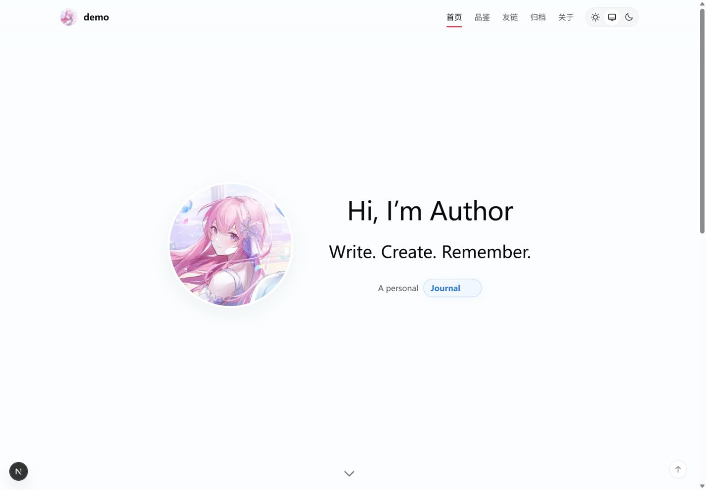

### 文章封面与置顶

置顶与普通文章分区展示，卡片包含封面、分类、日期、标签、字数和阅读时间。


### 分类筛选与站点统计

选择分类后只显示对应文章。侧栏汇总文章数、分类数、标签数、总字数和运行天数；访问统计默认关闭，未读取到数据时显示破折号。


### 文章索引与分页

文章索引沿用首页的封面卡片、个人资料侧栏和分类筛选，并提供分页入口。当前示例只有三篇文章，均在第一页，因此上一页与下一页处于不可用状态；文章增多后会按页显示。


### 文章目录与阅读进度

阅读页展示文章信息、章节目录和阅读进度，目录可以跳转到对应章节。

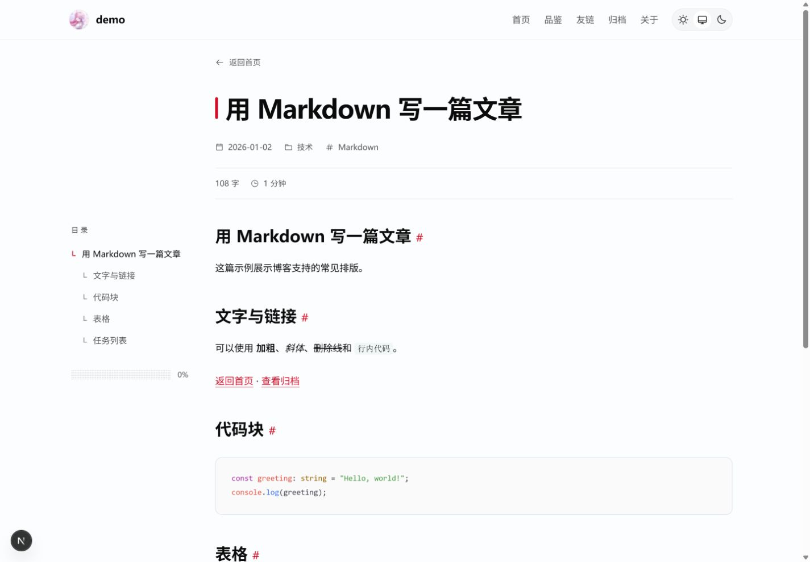

### 代码高亮、表格与任务列表

正文支持常用的标记语法，包括加粗、斜体、链接、代码块、表格和任务列表。

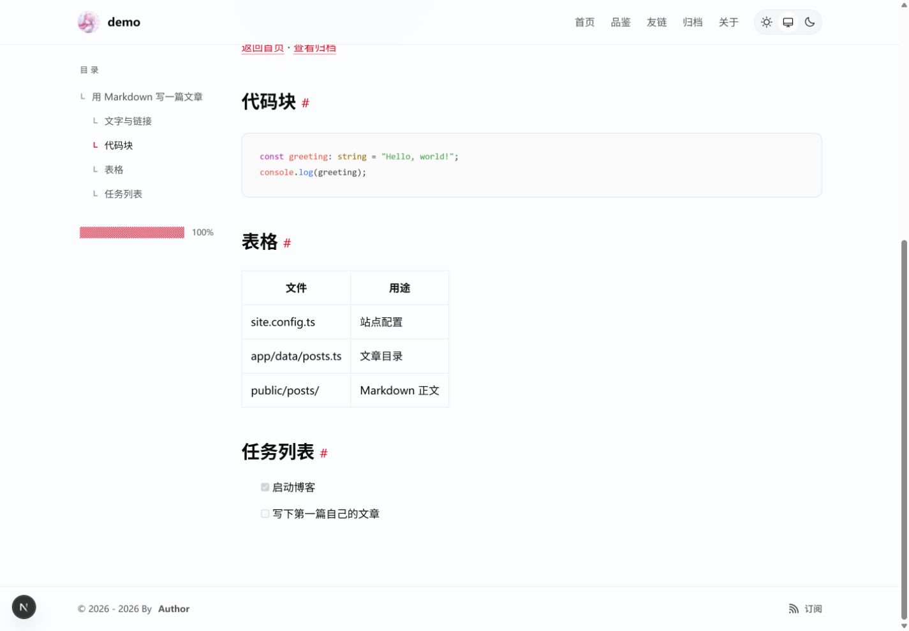

### 文章归档

按年份和发布日期整理文章，可从时间线进入正文。

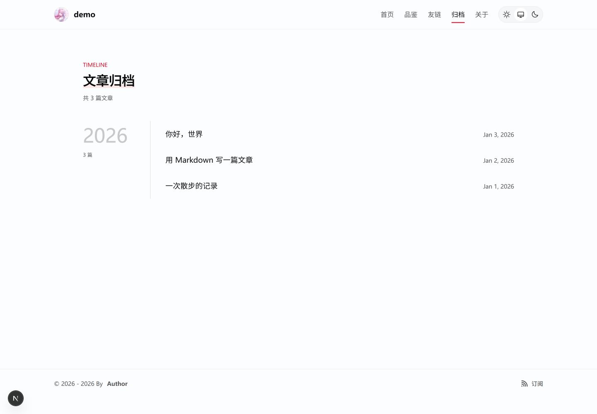

### 书籍、漫画与游戏收藏

不同类型分别展示，使用各自的分类、封面与信息。下面均为虚构演示条目，可直接替换。

| 书籍 | 漫画 |
| --- | --- |
| 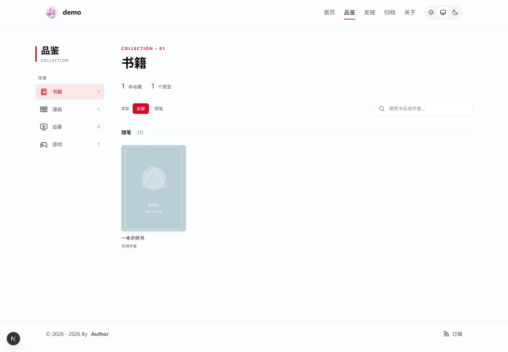 | 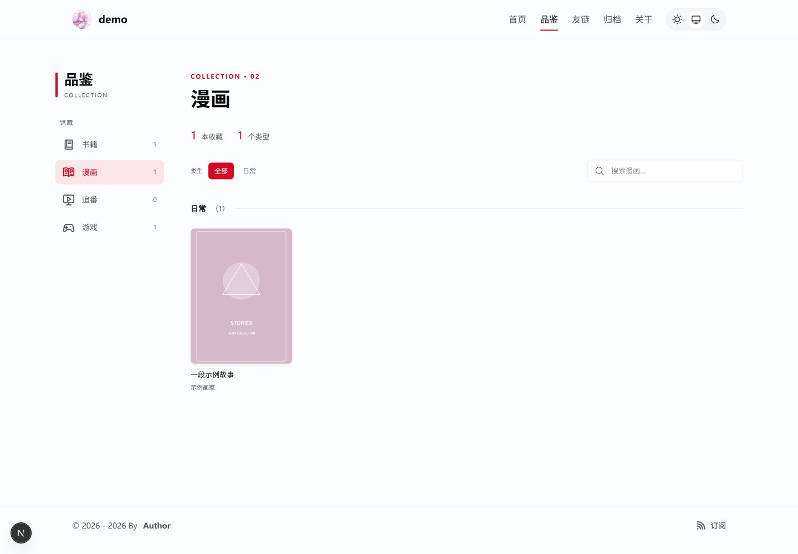 |

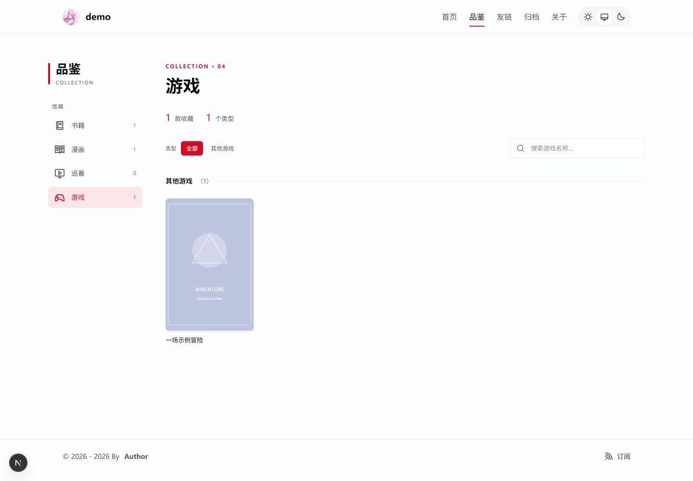

### 收藏搜索与筛选

支持按名称、作者等信息搜索，并按类型筛选。没有匹配结果时提供清空搜索和重置入口。

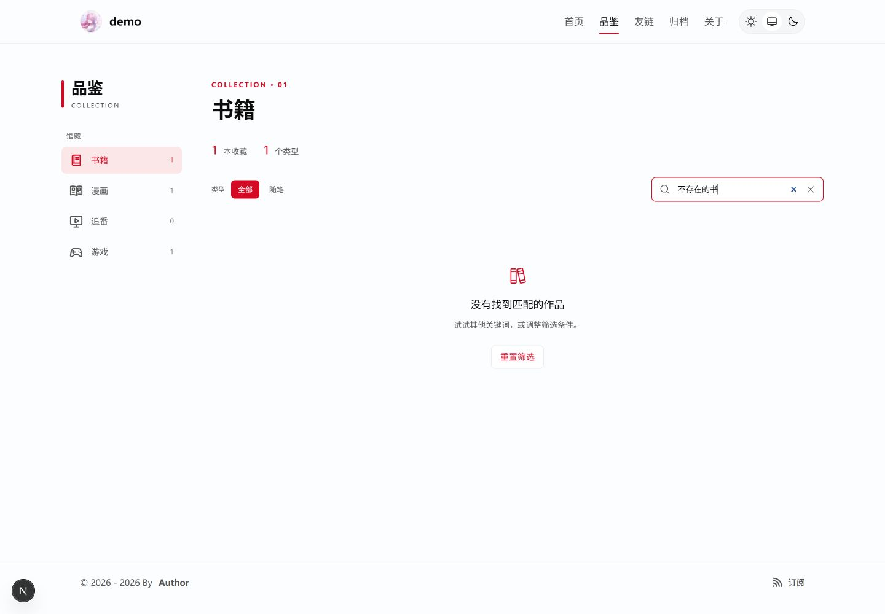

### 作品详情弹窗

点击封面打开作品详情，查看简介、作者或游玩信息。书籍和漫画使用展开书页的布局。

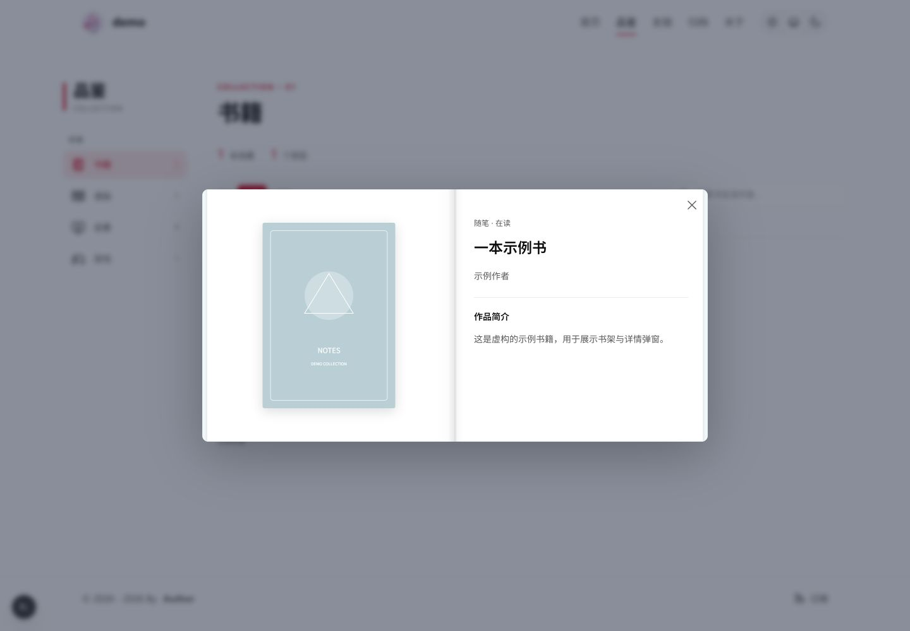

### 追番收藏

配置自己的 Bangumi 账号后读取收藏。当前没有绑定账号，截图展示空列表状态。

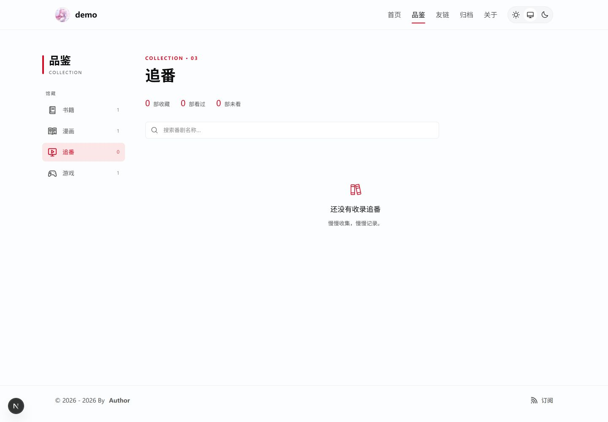

### 个人介绍

统一配置中的头像、位置和介绍段落展示在关于页面，可根据自己的情况修改。


### 技术栈、中文字体与贡献日历

品牌图标和用途说明组成技术栈卡片；中文使用本地思源黑体，英文与数字保留系统字体。下方贡献日历可以接入自己的 GitHub 账号，当前截图为未配置状态。

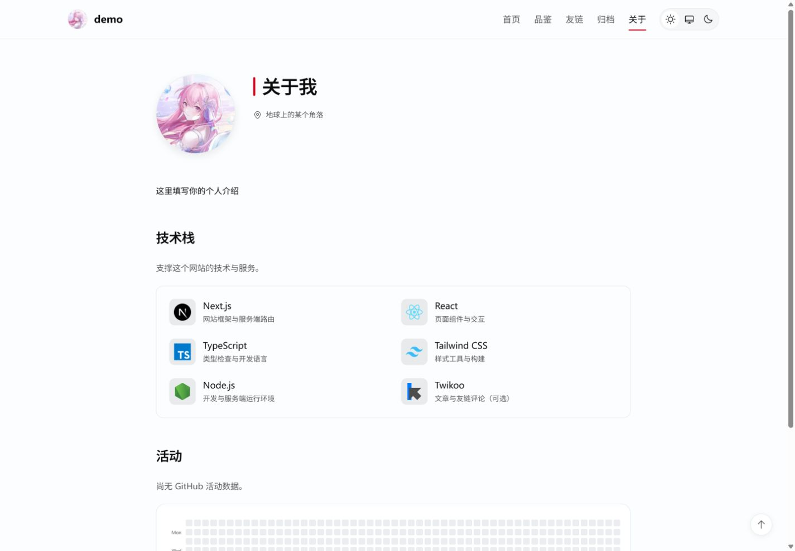

### 友链卡片

展示友人的头像、名称和简介，点击后进入对方站点。示例按站长要求收录了一条友链。


### 友链交换与资料复制

交换区自动读取站点配置，展示名称、头像地址、网址和简介，并提供复制资料的入口。

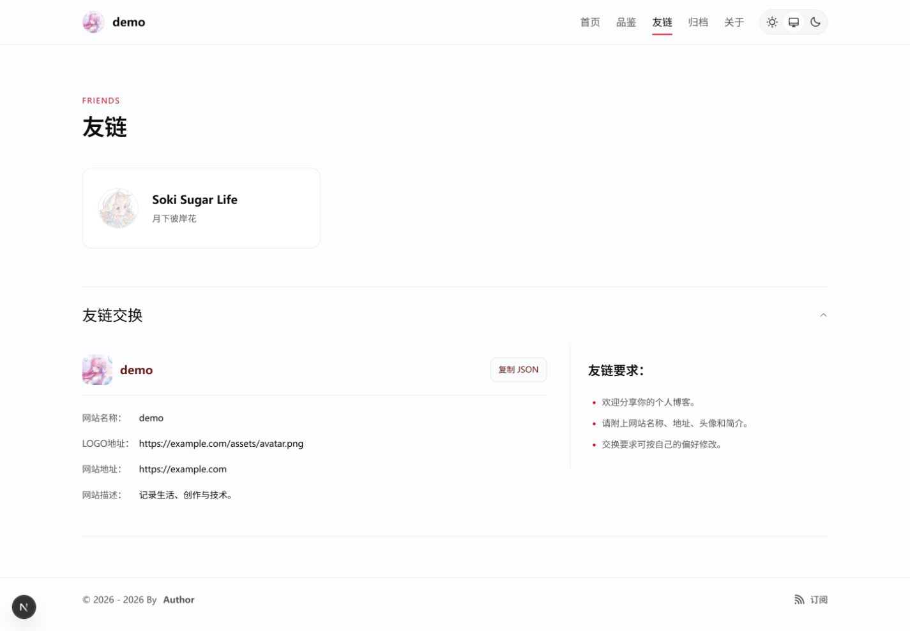

### 浅色、深色与跟随系统

可以手动选择浅色或深色，也可以跟随操作系统。主题切换保留过渡动效，并尊重系统的减少动态效果设置。

| 浅色界面 | 深色界面 |
| --- | --- |
|  | 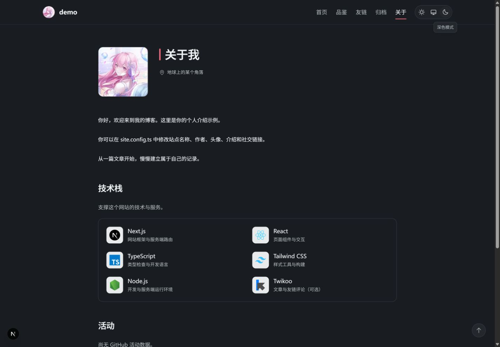 |

### 手机布局与抽屉导航

手机上使用单列布局与抽屉菜单；菜单中提供个人信息、导航、站点统计和分类入口。

| 手机首页 | 手机菜单 | 手机阅读 |
| --- | --- | --- |
|  | 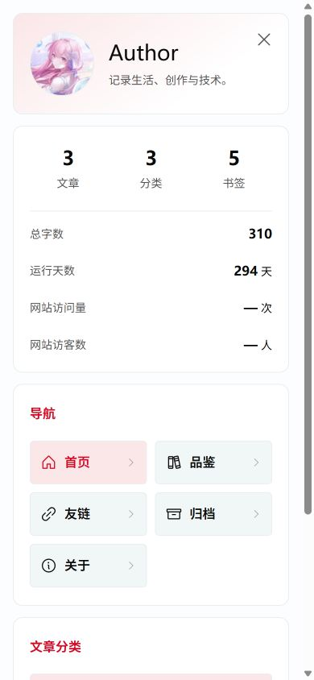 | 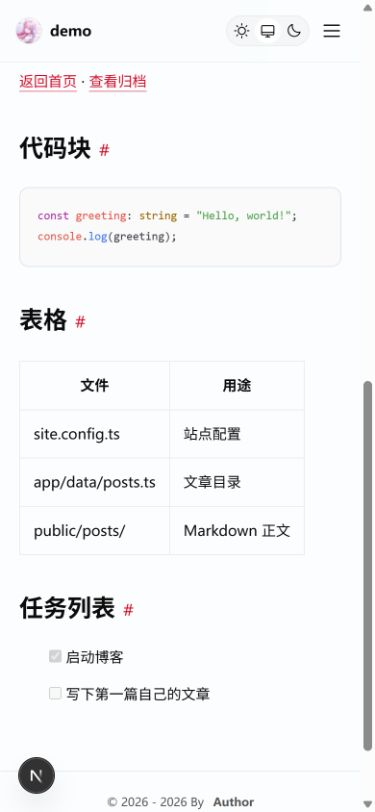 |

### 订阅源

`/api/rss` 根据文章目录生成订阅内容，包含标题、摘要、发布时间、分类和文章地址。截图中的域名是示例配置，上线前请改为自己的域名。

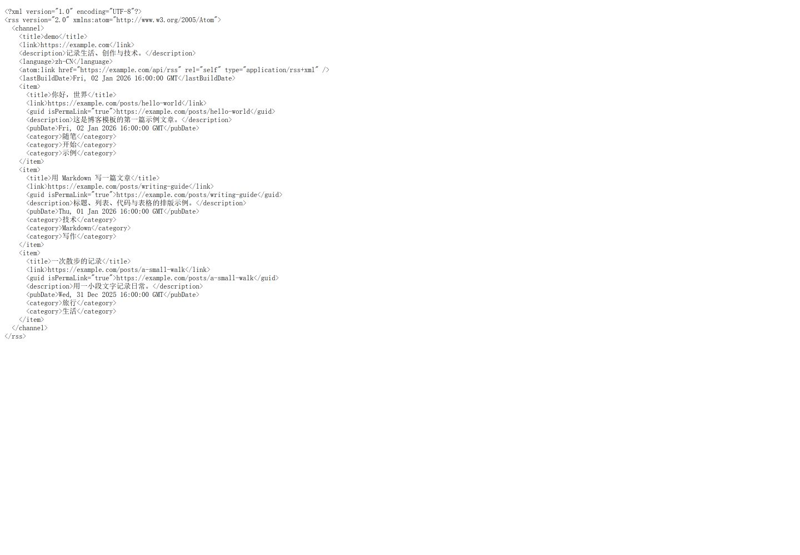

## 可以用它记录什么

| 想做的事情 | 对应功能与入口 |
| --- | --- |
| 写文章 | 在 `public/posts/` 编写正文，在 `app/data/posts.ts` 维护标题、分类、日期和标签 |
| 整理文章 | 首页分类筛选、置顶与分页，归档页按时间整理文章 |
| 收藏作品 | 品鉴页展示书籍、漫画、动画和游戏，支持搜索、筛选与详情弹窗 |
| 介绍自己 | 修改统一站点配置中的头像、简介、位置与社交链接 |
| 结识朋友 | 维护友链卡片，展示交换信息并复制站点资料 |
| 和读者交流 | 按需接入自己的 Twikoo 评论服务 |
| 提供订阅 | 根据文章目录自动生成 `/api/rss` |

核心页面不要求数据库或第三方账号。GitHub 活动、Bangumi 追番、Steam、音乐歌单和访问统计按需启用。

## 本地启动

需要 **Node.js 22.13 或更新版本** 和 npm。

下载或克隆源码，在项目根目录运行：

```bash
npm ci
npm run dev
```

打开 [http://localhost:3000](http://localhost:3000) 查看。第一次安装依赖需要联网；日常开发中，保存源码后页面会自动更新。

接着修改 `site.config.ts` 中的站点名称、作者、域名、头像和介绍，再将演示文章换成自己的内容。环境变量全部可选，不创建 `.env.local` 也能启动。

## 写作与内容

### 创建第一篇文章

在 `public/posts/` 新建 `my-first-post.md`：

```markdown
# 我的第一篇文章

今天开始，记录一些值得留下的事情。

## 随手记下

- 一段想法
- 一次经历
- 一个正在尝试的新方向
```

然后在 `app/data/posts.ts` 的 `localPosts` 数组中添加：

```ts
{
  slug: "my-first-post",
  title: "我的第一篇文章",
  date: "2026-01-01",
  description: "从一小段文字开始。",
  source: "/posts/my-first-post.md",
  cover: "/assets/cover.svg",
  type: "tech",
  category: "随笔",
  tags: ["生活"],
}
```

保存后访问 `/posts/my-first-post`。文章列表、分类、归档、订阅源和字数统计共用这份目录。

`slug` 保持唯一，`category` 使用文件内 `postCategories` 定义的分类。封面可以省略，省略后使用配置中的默认图片。首页置顶文章由 `app/components/HomePageClient.tsx` 中的 `pinnedPostSlugs` 设置。

### 管理其他内容

| 内容 | 修改位置 |
| --- | --- |
| 文章正文 | `public/posts/` |
| 文章信息与分类 | `app/data/posts.ts` |
| 书籍、漫画与游戏 | `app/collection/data.ts` |
| 友链 | `data/friends.json` |
| 技术栈展示 | `app/about/data.ts` |
| 头像和封面 | `public/assets/` |

默认收录了一条 [Soki Sugar Life](https://www.soki.moe) 友链，可按自己的需要保留或调整。演示文章与收藏条目均可替换。

## 配置与文档

公开站点信息集中在 `site.config.ts`。上线前，将 `url` 改为自己的正式域名，不带结尾 `/`；页面元数据、文章链接、订阅源和友链交换信息都会使用它。

| 想调整的内容 | 去哪里看 |
| --- | --- |
| 网站名称、作者、头像、简介、社交链接 | `site.config.ts` 与 [配置说明](docs/configuration.md) |
| 文章、收藏和友链的数据格式 | [配置说明](docs/configuration.md) |
| 中文字体和英文回退顺序 | `app/fonts.css` 与 [字体来源](public/fonts/source-han-sans/SOURCES.md) |
| 创建独立仓库和发布源码 | [发布说明](docs/publishing.md) |
| 当前检查结果和验证范围 | [验证记录](docs/verification.md) |

### 可选服务

将 `.env.example` 复制为 `.env.local`，只填写需要的配置：

| 环境变量 | 用途 |
| --- | --- |
| `NEXT_PUBLIC_TWIKOO_ENV_ID` | 自己的评论服务地址 |
| `GITHUB_USERNAME` | 贡献日历使用的账号 |
| `BANGUMI_USER_ID` | 追番收藏使用的账号 |
| `BANGUMI_ACCESS_TOKEN` | 可选的服务端访问令牌 |
| `STEAM_ID`、`STEAM_API_KEY` | 游戏账号与服务端接口密钥 |
| `APPLE_MUSIC_PLAYLIST_URL` | 公开的音乐歌单地址 |

评论未配置时隐藏，追番未配置时为空，贡献日历未配置时显示无数据。音乐和游戏卡片作为可复用组件保留，默认首页没有挂载。访客统计在 `site.config.ts` 的 `traffic` 中配置，仅在指定正式域名启用。

公开配置中只放公开信息。带 `NEXT_PUBLIC_` 前缀的变量会进入浏览器，访问令牌和接口密钥使用不带此前缀的服务端变量。修改环境变量后重启开发服务器，部署环境则重新部署。

## 部署

先验证生产构建：

```bash
npm run build
npm start
```

| 方式 | 操作 | 运行要求 |
| --- | --- | --- |
| Vercel 等支持 Next.js 的平台 | 导入自己的仓库，使用 `npm ci` 安装、`npm run build` 构建 | 由平台运行服务端页面与接口 |
| 自己的服务器 | 安装依赖、构建，再用 `npm start` 启动 | Node.js 运行环境，可通过 `PORT` 指定端口 |

项目包含服务端文件读取和接口路由，需要支持 Node.js 的部署环境，不能直接作为纯静态文件放到 GitHub Pages。

可以将这份源码创建为独立仓库，再将仓库设置为模板仓库，方便其他人创建自己的博客。具体命令见 [发布说明](docs/publishing.md)。

## 使用前了解

- **内容维护**：文章与个人资料通过源码文件维护，部署后生效；示例没有后台编辑器。
- **演示数据**：网站名称、示例作者、域名和文章用于展示，上线前替换成自己的信息。
- **字体**：中文使用本地[思源黑体](https://github.com/adobe-fonts/source-han-sans)，英文和数字保留原有系统字体；字体许可随文件提供。
- **外部服务**：评论、追番、游戏数据、音乐和访问统计依赖对应服务；公开页面解析可能随上游变化而失效。
- **演示素材**：头像、插画与品牌图标分别保留原有权利和许可，详情见[第三方说明](THIRD_PARTY_NOTICES.md)。
- **源码范围**：独立源码不包含原站文章、照片、环境文件或旧仓库历史；指定的示例素材和站长友链按要求保留。

## 开发与检查

```bash
npm run check:release
npm run lint
npm run typecheck
npm test
npm run build
```

仓库提供自动检查工作流，在推送和拉取请求时运行。单元测试覆盖订阅源、分页、收藏排序、文本解析与访问计数。

发布检查会核对必要文件、文章正文、静态图片引用，以及意外加入的环境文件、日志和仓库打包文件；它不是通用密钥扫描器。

## 项目结构

```text
site.config.ts          公开站点配置
app/                    页面、组件、服务端接口和样式
  about/                关于页面与技术栈数据
  collection/           收藏页面与示例数据
  data/                 文章目录和相册数据
  lib/                  数据解析与通用逻辑
data/                   友链与封面映射
public/
  assets/               头像、封面和演示素材
  fonts/                思源黑体与字体许可
  icons/                技术图标与来源说明
  posts/                文章正文
docs/
  images/               说明文档截图
  configuration.md      配置说明
  publishing.md         发布说明
tests/                  单元测试
.github/workflows/      自动检查工作流
```

## 鸣谢

本项目使用 Next.js、React、TypeScript、Tailwind CSS、Phosphor Icons 及相关开放源代码依赖构建，感谢这些项目的开发者与维护者。

## 许可

模板代码与原创矢量占位图采用 [MIT 许可](LICENSE)。

演示头像、文章插画、友链头像、字体和品牌图标适用各自的权利与许可，不统一适用模板代码的许可。说明文档中的截图使用同一批演示素材；自行添加的文章和素材可以另行声明许可。
